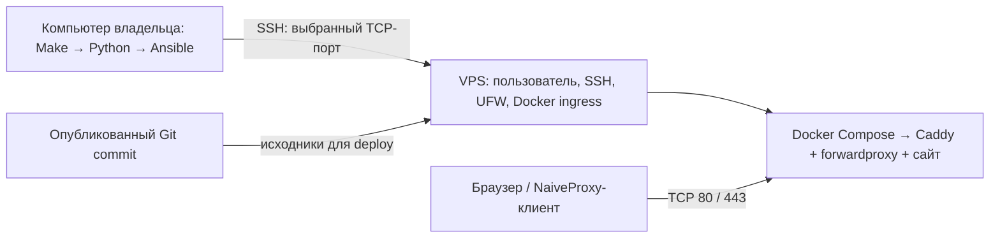

# Naive Gateway for VPS

Личный HTTPS-proxy на одном VPS: Caddy выдаёт сертификат, показывает обычный
статический сайт и обрабатывает авторизованные proxy-запросы через модуль
forwardproxy. Сайт нужен для обычных HTTPS-запросов; proxy не объявляет себя
неавторизованному посетителю. Настройка NaiveProxy-клиента в этот проект не входит.

Поддерживается **чистый Ubuntu 26.04 LTS amd64, только IPv4**. Реальная приёмка
на таком VPS ещё не выполнена; локальные тесты её не заменяют.

## Как устроен проект



- **Make** даёт короткие команды; он не читает и не экспортирует секреты из `.env`.
- **Python controller** работает на вашем компьютере: читает настройки,
  проверяет DNS/SSH, спрашивает пароли и запускает Ansible.
- **Ansible** выполняет изменения на VPS по SSH. Его *playbook* — последовательность
  действий; *role* — группа действий для одной задачи, например настройки Docker;
  *task* — отдельное действие; *handler* — действие при изменении файла, например reload.
- *Inventory* — список серверов. Controller передаёт один host и его параметры
  при запуске; отдельный inventory с паролями заполнять не нужно.
- **Docker Compose** запускает один Caddy-контейнер. *Release* — snapshot исходников
  одного commit; *rollback* возвращает предыдущий release, настройки и контейнер.
- *Идемпотентность* означает, что повторный запуск приводит сервер к тому же
  состоянию без ненужных изменений и без смены сохранённых credentials.

Например, `make provision` вызывает `.venv/bin/gateway-controller provision --config .env`.
Разбор команды находится в [cli.py](src/naive_gateway_controller/cli.py), порядок
вызовов — в [provisioning.py](src/naive_gateway_controller/provisioning.py);
серверные шаги — в `provisioning/playbooks/` и `provisioning/roles/`.

## 1. Подготовить компьютер и VPS

На компьютере нужны Python **3.14.10** (patch закреплён в `.python-version`), Git,
Make и OpenSSH (`ssh`, `ssh-keygen`).
Ansible и остальные Python-инструменты установятся в локальную `.venv`.
Docker на компьютере нужен для интеграционных тестов, для самой установки он не нужен.

Получите проект и перейдите в его каталог — дальнейшие controller-команды
выполняются здесь, на вашем компьютере:

```bash
git clone https://github.com/s1azzy-dev/vps_naive_config.git
cd vps_naive_config
```

На VPS нужны исходный SSH-доступ по ключу и доступная консоль провайдера.
Исходный пользователь обычно `root`; non-root пользователь должен иметь sudo.
Выбранный SSH-порт уже должен работать: проект его не переносит.
Откройте этот TCP-порт, `80/tcp` и `443/tcp`. UDP/443 не используется;
SSH-порт не может быть 80 или 443. Provider firewall необязателен:
Ansible настроит UFW и отдельную защиту Docker ingress внутри VPS.

Подготовьте SSH-ключ. Если отдельного ключа ещё нет, создайте его и добавьте
публичную часть на VPS средствами провайдера:

```bash
ssh-keygen -t ed25519 -f ~/.ssh/naive_vps
```

Для зашифрованного ключа заранее загрузите его в `ssh-agent` через `ssh-add`:
controller использует неинтерактивный SSH. Проверьте исходный доступ вручную:

```bash
ssh -4 -p 22 -i ~/.ssh/naive_vps root@203.0.113.10
```

Замените порт, пользователя и IP на свои. Сверьте первый fingerprint с данными
из консоли провайдера. Оставьте эту сессию открытой до проверки нового входа.
У controller свой `provisioning/known_hosts`: первый ключ запоминается через
`accept-new`, изменившийся ключ автоматически не принимается.

У домена создайте `A` на IPv4 VPS и удалите `AAAA`. Все его A-записи должны
соответствовать адресам VPS; до продолжения дождитесь обновления DNS.

## 2. Заполнить локальную конфигурацию

```bash
make init
```

Команда копирует `.env.example` в `.env` с правами `0600` — читать может только
владелец. Существующий файл не перезаписывается. Откройте `.env` в редакторе:

| Поле | Обязательно / значение по умолчанию | Назначение и пример |
| --- | --- | --- |
| `VPS_HOST` | Да | IPv4 или имя VPS: `203.0.113.10` |
| `VPS_PORT` | `22` | Действующий SSH TCP-порт, кроме 80/443 |
| `VPS_BOOTSTRAP_USER` | `root` | Исходный пользователь для первой настройки |
| `VPS_USER` | `slazzy` | Новый постоянный non-root пользователь; отличается от bootstrap user |
| `SSH_PRIVATE_KEY` | Да | Абсолютный путь, например `/Users/you/.ssh/naive_vps`; без `~` |
| `SSH_PUBLIC_KEY` | Путь приватного ключа + `.pub` | Явный абсолютный путь, если публичная часть хранится отдельно |
| `DOMAIN` | Да | Домен gateway: `gateway.example.com` |
| `ACME_EMAIL` | Да | Контакт для сертификата: `you@example.com` |
| `GATEWAY_REPOSITORY` | `https://github.com/s1azzy-dev/vps_naive_config.git` | Исходники, доступные VPS; public HTTPS или SSH deploy key |
| `GATEWAY_REF` | `main` | Опубликованная ветка, tag или полный commit для deploy |
| `NAIVE_USER` | Пусто | Оставить пустым для генерации либо задать вместе с password |
| `NAIVE_PASSWORD` | Пусто | Вместе с user: только буквы, цифры и `._~-` |

Обычно достаточно заполнить `VPS_HOST`, `SSH_PRIVATE_KEY`, `DOMAIN`, `ACME_EMAIL`.
Sudo-пароли в `.env` не записываются. Файл не копируется на VPS и не коммитится.

VPS скачивает **опубликованный** `GATEWAY_REF`, а не рабочее дерево компьютера.
Для private Git настройте SSH deploy key у root на VPS до deploy. URL с HTTPS
userinfo/token или SSH password запрещены. По умолчанию proxy credentials
генерируются один раз; последующие deploy с пустой парой сохраняют их.
Явно заданная пара применяется при каждом deploy.

## 3. Установить инструменты и развернуть gateway

```bash
make tooling
make provision
```

`make tooling` создаёт `.venv`, устанавливает зависимости из `uv.lock` и
Ansible collections из `provisioning/requirements.yml`, затем проверяет их.
Если `python3` другой версии, используйте `make tooling PYTHON=python3.14`.
Успешная подготовка заканчивается `Tooling: OK`.

`make provision` выполняет следующие действия:

| Шаг | Что вызывается и зачем |
| --- | --- |
| Конфигурация | Python проверяет `.env`, поля и файлы ключей, не печатая секреты |
| Синтаксис | Ansible разбирает bootstrap/deploy/verify/restore до первого обращения к VPS |
| Preflight | Python проверяет DNS, доступность SSH-порта, host key и доступ постоянного либо исходного пользователя |
| Bootstrap | `bootstrap.yml`: готовит пользователя, SSH и firewall; выполняется и при уже готовом managed SSH |
| Deploy | `deploy.yml`: устанавливает Docker, готовит release и запускает проверенный Caddy |
| Verify | `verify.yml`: проверяет доступ, firewall, установленный release, порты и HTTPS/proxy |
| Результат | Python читает серверные credentials через SSH/sudo и показывает endpoint/user/password |

Первый provision спрашивает новый sudo-пароль `VPS_USER` дважды. Для non-root
bootstrap отдельно спрашивается его **существующий** sudo-пароль; пустой ответ
допустим только при исходном NOPASSWD. Повторный provision спрашивает действующий
пароль постоянного пользователя один раз. Пароли передаются Ansible через pipe,
не через аргументы процесса, environment или временный файл.

### Что делает bootstrap

1. Через исходного пользователя проверяет/устанавливает Python и sudo, сверяет
   ОС, архитектуру и часы — это prerequisites для Ansible и TLS.
2. Создаёт `VPS_USER`, группу, sudo-доступ и ровно выбранный публичный ключ.
   Существующий неуправляемый account отклоняется, его ключи и группы не стираются.
3. Открывает новый SSH-сеанс постоянного пользователя и проверяет прямой
   password-backed sudo. Его NOPASSWD не считается доказательством верного пароля.
4. Проверяет всю SSH-конфигурацию, устанавливает drop-in и выполняет reload
   только после успешной проверки. Root/password/keyboard-interactive SSH запрещаются.
5. Настраивает UFW: входящие соединения запрещены, разрешены выбранный SSH TCP
   с limit и TCP 80/443. В `DOCKER-USER` добавляется отдельный allowlist:
   публикации Docker не должны обходить ограничения UFW.
6. Проверяет reconnect по ключу постоянного пользователя и отказ root/password SSH.
   При повторе host roles согласуют состояние; пароль существующего account не меняется.

После успеха проверьте новый вход в отдельном терминале, прежде чем закрывать исходный:

```bash
ssh -4 -p 22 -i ~/.ssh/naive_vps slazzy@203.0.113.10
sudo -k true
```

### Что делает deploy

1. Проверяет managed sudo и ownership; устанавливает Docker Engine/Compose из
   официального apt repository с закреплённым SHA-256 ключа.
2. Применяет Docker publication defaults: loopback для неявных bridge publications,
   iptables backend, запрет direct routing. Пользователь не включается в Docker group.
3. Проверяет конфликты портов, восстанавливает незавершённую предыдущую активацию,
   получает нужный Git ref и экспортирует release в отдельный каталог commit.
   Так обновление checkout не меняет bind mounts работающего контейнера.
4. Сохраняет имеющиеся credentials, применяет явную пару или генерирует новую.
   Подготовленный `gateway.env.pending` сохраняется для повтора после прерывания.
5. Проверяет Compose boundary, собирает закреплённый Caddy image и выполняет
   `caddy validate` без подключения действующих certificate volumes.
   При сборке Dockerfile скачивает Caddy и forwardproxy по `versions.env`,
   применяет upstream-патчи QUIC и idle timeout из этого же commit forwardproxy
   и собирает единый бинарник через xcaddy. Исходники и Go остаются в build stage.
6. Сохраняет предыдущие env/release, атомарно активирует env и ожидает health Caddy.
7. Проверяет публичный HTTPS и `check-server.sh`: сайт, TLS/HTTP2, CONNECT с
   авторизацией, явный отказ без неё и отсутствие proxy destinations в логах.
8. Переключает `current` на принятый release. Ошибка активации возвращает прежний
   env/release/container; первый неуспешный deploy останавливается с сохранением pending credentials.

Успех полного цикла: `Provisioning: PASS`, затем endpoint и credentials.
Provision и выдача credentials требуют интерактивный терминал. Ошибка не считается
успешной установкой; controller подсказывает команду для продолжения.

## 4. Обновление и проверка

На компьютере обновите checkout (`git pull --ff-only`), после изменения зависимостей
выполните `make tooling`. Укажите нужный опубликованный `GATEWAY_REF`, затем:

```bash
make deploy
make verify
```

Deploy сам выполняет acceptance; отдельный verify дополнительно проверяет host state.
Verify сверяет установленный marker/current/image без source Git на VPS и доступа
к origin. Новый commit в удалённом main не делает установленный gateway неисправным.
Если `GATEWAY_REF` — полный commit, verify требует именно его. Он всё ещё требует
исправные DOMAIN DNS и публичный HTTPS; release marker не доказывает происхождение Git.

Все команды этой таблицы выполняются **на компьютере владельца**:

| Команда | Действие / результат |
| --- | --- |
| `make help` | Показывает доступные команды без конфигурации |
| `make init` | Создаёт приватный `.env`, сохраняя существующий |
| `make tooling` | Устанавливает локальные инструменты и collections |
| `make tooling-check` | Проверяет установленные инструменты и lock без настройки VPS |
| `make check-config` | Проверяет только локальные настройки и ключи, без VPS |
| `make preflight` | Проверяет DNS/TCP/SSH, запоминает первый host key локально; сервер не меняет |
| `make bootstrap` | Настраивает account/SSH/firewall; standalone запрашивает managed пароль с подтверждением |
| `make deploy` | Устанавливает Docker и разворачивает указанный release |
| `make provision` | Выполняет полный цикл с verify и выводом credentials |
| `make verify` | Проверяет установленный gateway без перенастройки |
| `make credentials` | Показывает текущие credentials через SSH/sudo; DNS gateway для чтения не нужен |
| `make restore BACKUP_FILE=/absolute/backup.tar.gz` | Восстанавливает автономный backup на подготовленный пустой VPS |

## 5. Команды на VPS и данные

Следующие операции запускаются **на VPS** через постоянного пользователя:

```bash
sudo make -C /opt/naive-gateway/current status
```

Подставьте нужную цель вместо `status`; каждую запускайте отдельно:

| Цель Make | Что делает |
| --- | --- |
| `status` | Показывает состояние Caddy-контейнера |
| `logs` | Следит за последними логами; `Ctrl+C` завершает просмотр |
| `check` | Проверяет работающие site/TLS/HTTP2/proxy/health/log suppression |
| `validate` | Проверяет Compose/Caddy config без замены работающего сервиса |
| `restart` | Перезапускает Caddy |
| `backup` | Сохраняет автономный архив с image, runtime и certificate volumes |
| `rotate-credentials` | Создаёт новую пару, пересоздаёт Caddy и проверяет её; при ошибке возвращает прежнюю |

`check` проверяет работающий runtime, `validate` — конфигурацию, `verify` — также
настройки host. После rotation обновите либо очистите явную пару в локальном `.env`,
иначе следующий deploy вернёт её. Получить действующую пару: `make credentials` на компьютере.

| Путь на VPS | Назначение |
| --- | --- |
| `/opt/naive-gateway/repository` | Source Git checkout только для deploy |
| `/opt/naive-gateway/releases/<commit>` | Отдельные release-файлы и image override `deployment.yml` |
| `/opt/naive-gateway/current` | Ссылка на принятый release; `.release-complete` хранит commit |
| `/etc/naive-gateway/gateway.env` | Runtime domain/contact/credentials, `root:root 0600` |
| `/etc/naive-gateway/gateway.env.pending` | Приватный candidate env для validation/retry |
| `/etc/naive-gateway/user-managed-<user>`, `docker-managed` | Признаки ресурсов, созданных проектом |
| `/etc/naive-gateway/deployment-recovery` | Приватный snapshot незавершённой активации |
| `/etc/naive-gateway/previous-deployment`, `deployment-history` | Предыдущее принятое состояние и прежние snapshots |
| Docker volumes `naive-gateway_caddy_data`, `naive-gateway_caddy_config` | Сертификаты, private keys и Caddy config |
| `/var/backups/naive-gateway/` | Архивы backup `0600`, каталог `0700`; содержат секреты |

Не запускайте deploy/restore/backup/rotation параллельно. Автоматического prune
нет: сохраняются материалы восстановления, старые releases/images и backups.
Архив скопируйте с VPS в защищённое хранилище; копия только на том же диске
не поможет при потере сервера. Полные шаги: [восстановление и диагностика](docs/vps-setup.md).

## Проверки проекта и дальнейшая навигация

На компьютере, после `make tooling`:

| Команда | Что проверяет |
| --- | --- |
| `make lint` | Ruff/format, mypy, shell syntax/ShellCheck, Ansible syntax/lint |
| `make ansible-check` | Только Ansible syntax и production ansible-lint |
| `make test` | Локальное поведение controller/recovery, конфигурацию и scoped release verification |
| `make molecule` | Реальные роли и recovery в disposable privileged Docker fixture |
| `./tests/smoke-local.sh` | Настоящий Caddy image: local TLS, сайт и proxy; image предварительно собран |

Для полного shell lint нужен установленный ShellCheck:
`REQUIRE_SHELLCHECK=1 make lint`. GitHub Actions запускает static checks, pytest,
Molecule и Caddy smoke без доступа к вашему VPS. Сборка и подготовка smoke описаны
в [provisioning/README.md](provisioning/README.md).

- [Восстановление и диагностика](docs/vps-setup.md) — сбои SSH, deployment, backup/restore и rotation.
- [Устройство provisioning и тесты](provisioning/README.md) — роли, test fixture и ограничения проверок.
- [Обновление зависимостей](docs/dependency-updates.md) — источники pins и порядок проверки обновлений.
- [Текущий checklist и приёмка](docs/ansible-provisioning-plan.md) — оставшиеся задачи и результаты.
